# UTS Manajemen Basis Data

## PostgreSQL, Docker Compose, pgAdmin 4, dan RBAC

Repositori ini adalah tugas UTS Manajemen Basis Data. Proyek membangun database PostgreSQL bertema inventaris komponen PCB menggunakan Docker Compose. Database dibuat secara reproducible melalui init script dan dibuktikan dengan constraint, hak akses role, view, trigger audit, serta transaksi rollback.

| Informasi | Nilai |
|---|---|
| Mahasiswa | Muhamad Khansa Khalifaturohman |
| NIM | 1247050115 |
| Database | `salam_db` |
| Schema | `SALAM` |
| Repositori | https://github.com/MKhansa067/UTS-Manajemen-Basis-Data |

## Tujuan

1. Menjalankan PostgreSQL dan pgAdmin secara terisolasi dengan Docker Compose.
2. Membuat role, schema, tabel, dan data awal secara otomatis.
3. Menerapkan role-based access control (RBAC) dengan hak berbeda.
4. Membuktikan constraint, view, trigger, dan transaksi melalui pengujian.

## Arsitektur

```text
Host Windows
  |-- localhost:22115 --> PostgreSQL :5432
  |-- localhost:44115 --> pgAdmin :80

Docker network: net_mkk
  |-- postgres (database salam_db)
  |-- pgadmin  (web administration)
```

pgAdmin menggunakan hostname internal Docker `postgres:5432`. DBeaver dari host menggunakan `localhost:22115`.

## Persyaratan

- Docker 20.10+
- Docker Compose v2+
- Git

## Cara Menjalankan

1. Clone repositori ini:
   ```bash
   git clone https://github.com/MKhansa067/UTS-Manajemen-Basis-Data.git
   cd UTS-Manajemen-Basis-Data
   ```

2. Salin `.env.example` menjadi `.env` dan isi password:
   ```bash
   cp .env.example .env
   ```
   Edit `.env` dan ganti semua `GANTI_DENGAN_PASSWORD` dengan password yang aman.

3. Jalankan container:
   ```bash
   docker compose up -d
   ```

4. Cek status container:
   ```bash
   docker compose ps
   ```

5. Akses:
   - **PostgreSQL eksternal:** `localhost:22115` (user `postgres`, password sesuai `.env`)
   - **pgAdmin:** http://localhost:44115 (email dan password sesuai `.env`)
   - **PostgreSQL internal (dari pgAdmin):** host `postgres`, port `5432`

## Inisialisasi Database

Folder `init/` dipasang ke `/docker-entrypoint-initdb.d/` dan diproses secara alfabetis saat volume PostgreSQL masih kosong.

| File | Fungsi |
|---|---|
| `01_roles.sh` | Membuat role aplikasi dari password environment |
| `02_schema_tables.sql` | Membuat schema `SALAM` dan lima tabel |
| `03_privileges.sql` | Mengatur hak akses dan default privileges |
| `04_views_triggers.sql` | Membuat view, fungsi stok, dan trigger audit |
| `05_seed.sql` | Mengisi data awal inventaris PCB |

## Struktur Database

Schema `SALAM` berisi tabel `mahasiswas`, `proyek_pcb`, `komponen`, `bom_items`, dan `audit_log`. Relasinya menghubungkan mahasiswa ke proyek, lalu proyek ke komponen melalui bill of materials (`bom_items`).

## Matriks Hak Akses

| Role | Hak akses |
|---|---|
| `backend_dev` | SELECT, INSERT, UPDATE, DELETE; tidak dapat melakukan DDL |
| `bi_dev` | SELECT pada tabel dan view biaya; tidak dapat mengubah data |
| `data_engineer` | Pemilik schema; DDL dan CRUD; tidak dapat membuat role |
| `postgres` | Administrator untuk setup dan verifikasi |

Akses publik ke schema dicabut. Default privileges menjaga agar objek baru oleh `data_engineer` mengikuti pola hak akses yang ditetapkan.

## Fitur Database

- `SALAM.v_biaya_bom_per_proyek`: agregasi biaya material per proyek.
- Trigger `komponen_audit_update`: mencatat perubahan stok/harga ke `audit_log`.
- `SALAM.kurangi_stok(part_number, jumlah)`: mengunci baris, memvalidasi ketersediaan stok, dan melakukan pengurangan dalam transaksi.

Contoh melihat view:

```sql
SELECT * FROM "SALAM".v_biaya_bom_per_proyek ORDER BY proyek_id;
```

Lihat audit terbaru:

```sql
SELECT * FROM "SALAM".audit_log ORDER BY id DESC;
```

## Pengujian

Pengujian constraint dari host:

```bash
docker compose exec -T postgres psql -U postgres -d salam_db < tests/10_constraint_tests.sql
```

Pengujian privilege membutuhkan `psql` lokal dan `.env`:

```bash
bash tests/20_privilege_tests.sh
```

Feature demo (view, trigger, rollback, dan commit):

```bash
docker compose exec -T postgres psql -U postgres -d salam_db < tests/30_feature_demo.sql
```

Folder `tests/` tidak dipasang di container, sehingga file SQL dikirim dari host melalui standard input. Output bukti ada di `docs/evidence/`.

## Screenshot dan Bukti Pelaksanaan

Dokumentasi screenshot di bawah mengikuti urutan checklist. Gambar berada pada `docs/screenshots/`. Screenshot `.env` sengaja tidak disertakan karena memuat kredensial; template aman tersedia pada `.env.example`.

### 01. Versi Docker dan Compose

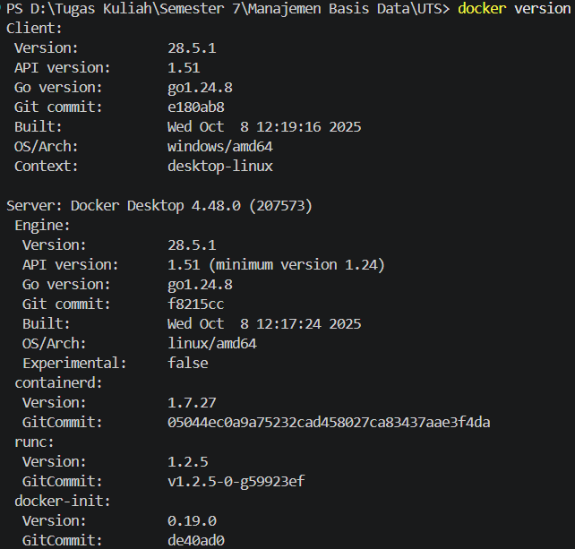

Memperlihatkan versi perangkat dan waktu pelaksanaan.

### 02. Konfigurasi environment

Tidak ditampilkan untuk menjaga keamanan password. File `.env` lokal diabaikan Git.

### 03. Konfigurasi Docker Compose

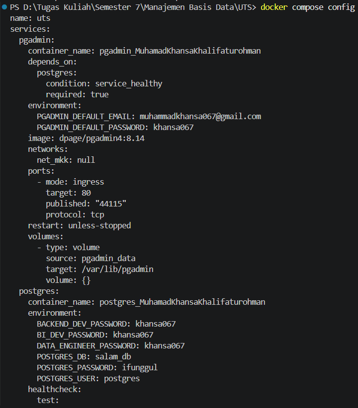
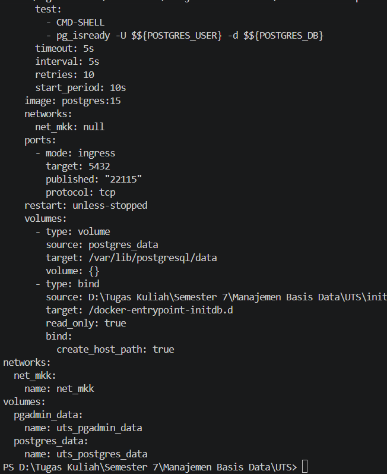

Menunjukkan definisi layanan, port, environment, volume, jaringan, healthcheck, dan dependency.

### 04. Container berjalan

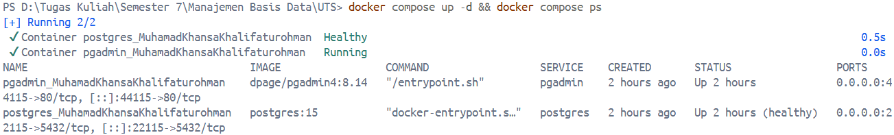

Bukti service berhasil dijalankan dan statusnya diperiksa.

### 05. Docker Desktop

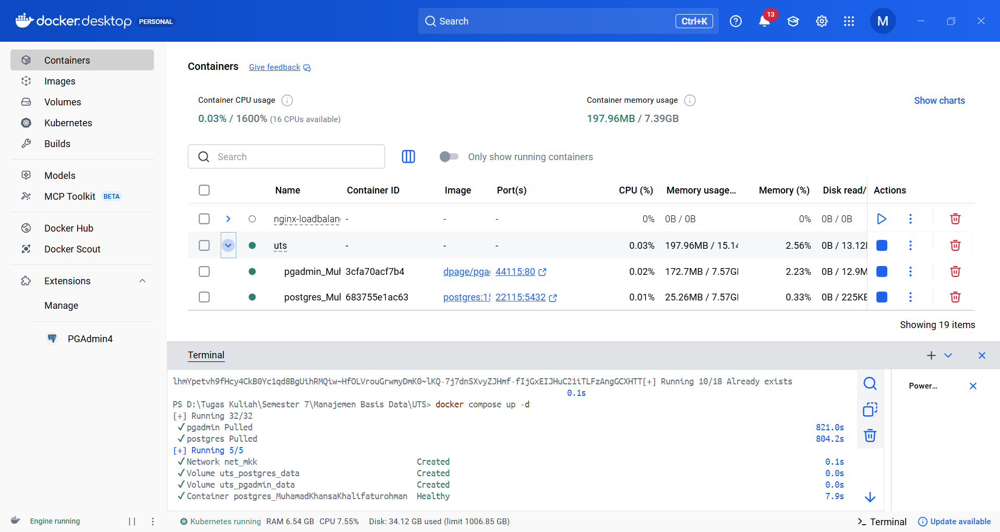

Bukti container PostgreSQL dan pgAdmin di Docker Desktop.

### 06. Login pgAdmin

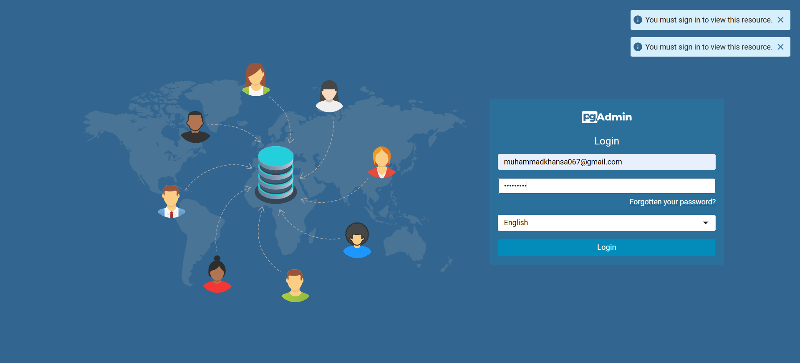

Akses antarmuka web pgAdmin melalui port `44115`.

### 07. Register server di pgAdmin

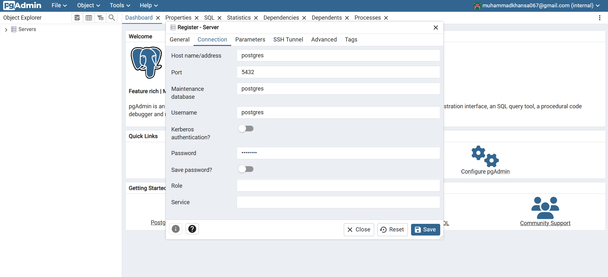

pgAdmin mendaftar koneksi internal menggunakan hostname `postgres` dan port `5432`.

### 08. Schema SALAM

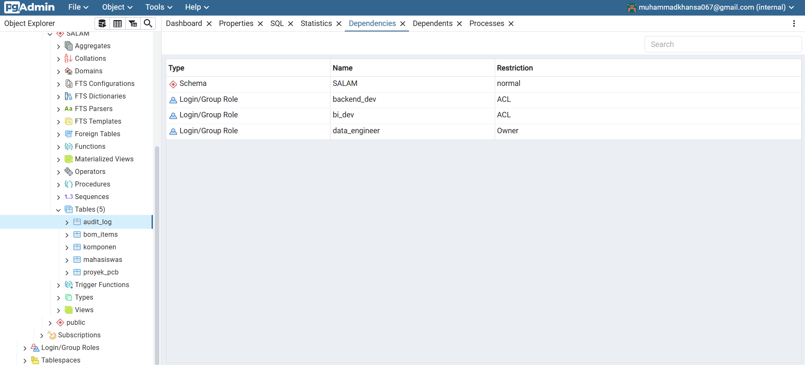

Schema dan objek database terlihat di pgAdmin.

### 09. Query melalui pgAdmin

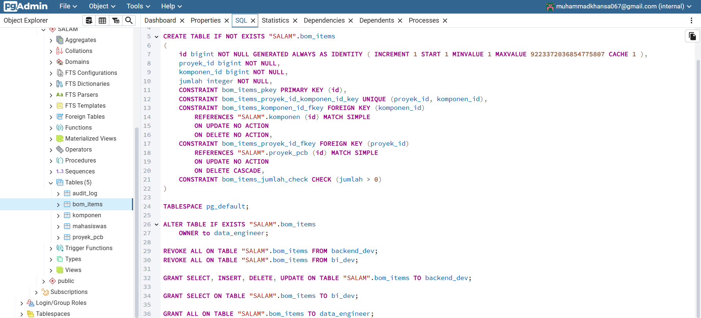

Query terhadap data mahasiswa.

### 10. Koneksi DBeaver

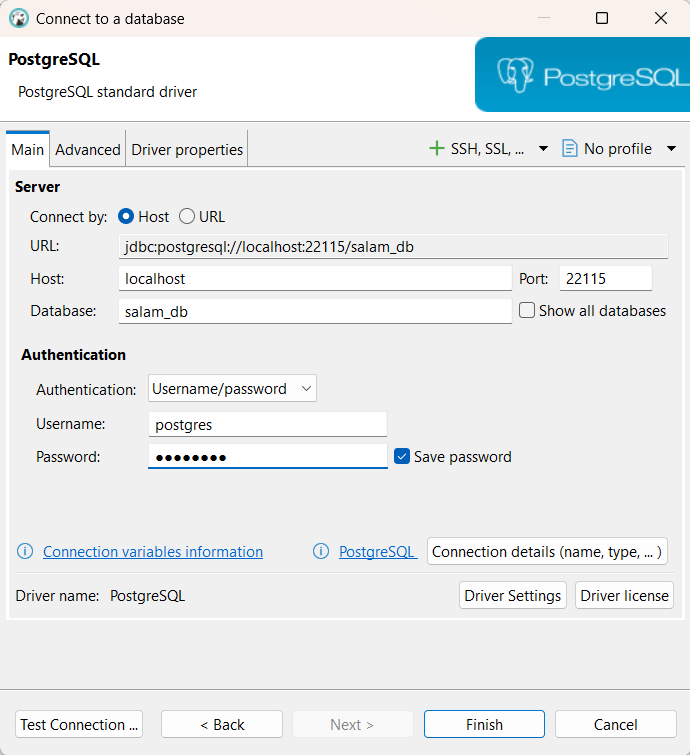
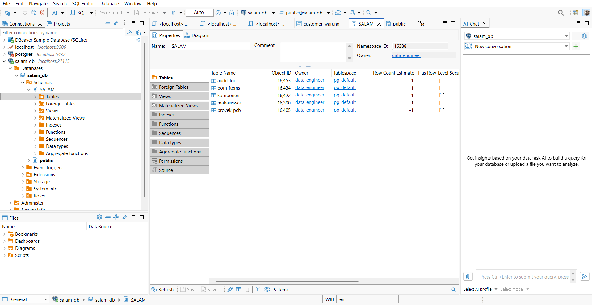

Konfigurasi koneksi dari host ke `localhost:22115`.

### 11. Uji koneksi DBeaver

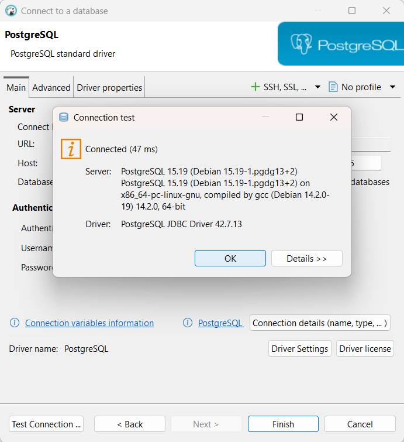

Bukti koneksi database berhasil diuji.

### 12. Query melalui DBeaver

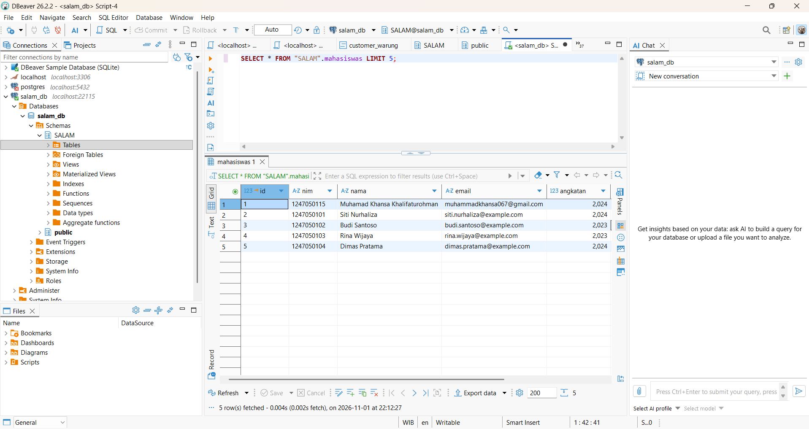

Query SQL dan hasil data dari PostgreSQL.

### 13. INSERT valid

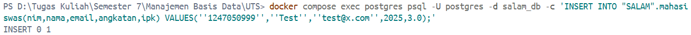

Baris dengan nilai yang memenuhi constraint berhasil ditambahkan.

### 14. Pelanggaran UNIQUE

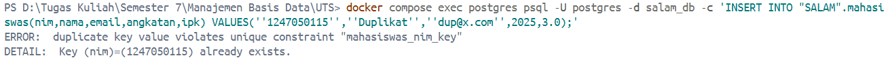

Database menolak NIM duplikat.

### 15. Pelanggaran CHECK

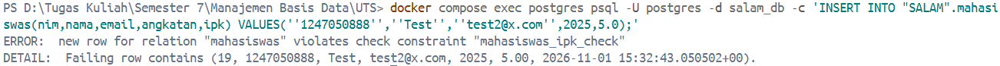

Database menolak nilai IPK `5.00`, di luar rentang yang diizinkan.

### 16. Daftar role

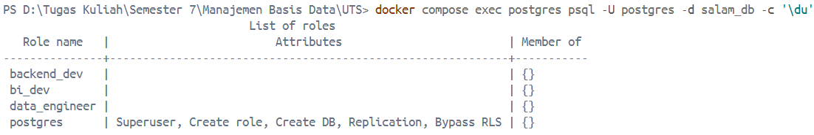

Menunjukkan role database yang digunakan dalam pengujian RBAC.

### 17. Hak akses backend_dev

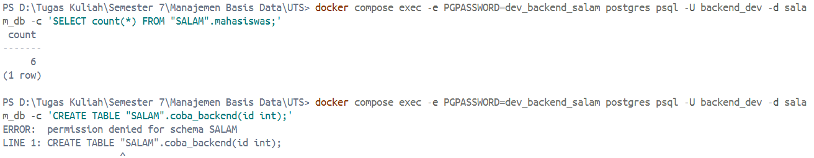

Operasi data yang diizinkan berhasil, sedangkan tindakan DDL ditolak.

### 18. Hak akses bi_dev

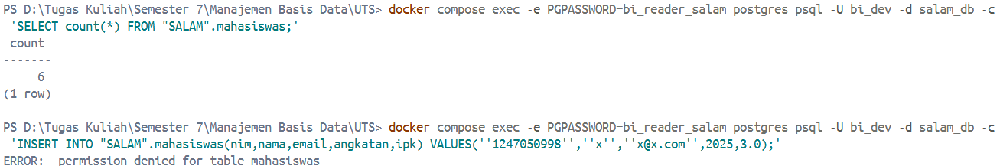

SELECT tabel dan view diizinkan, sedangkan perubahan data ditolak.

### 19. Hak akses data_engineer

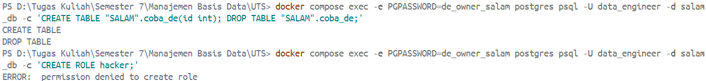

DDL dan operasi data pada schema diizinkan; pembuatan role ditolak.

### 20. View biaya BOM

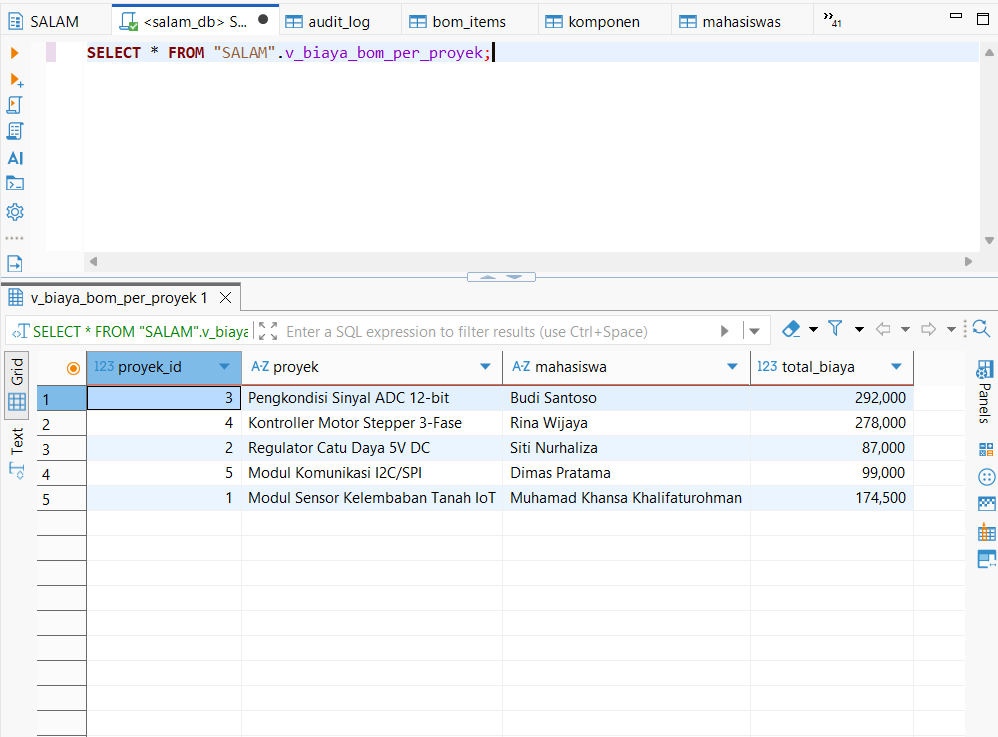

Hasil agregasi biaya komponen untuk setiap proyek PCB.

### 21. Trigger audit

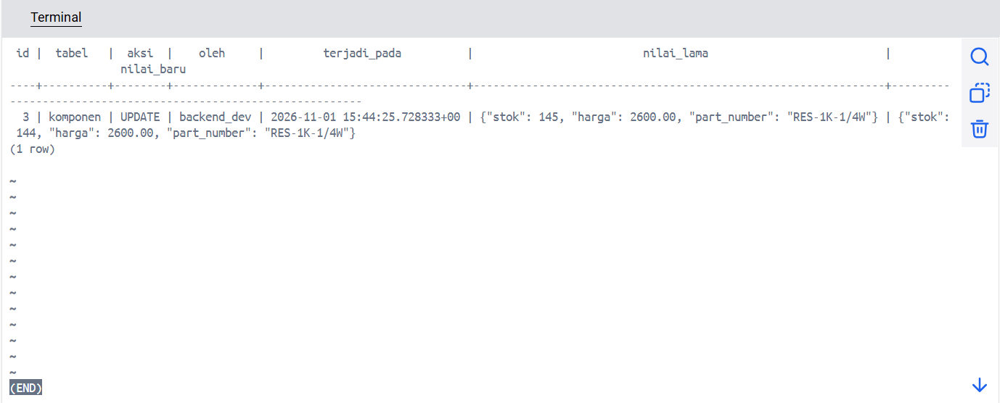

Perubahan stok komponen otomatis dicatat pada tabel `audit_log`.

### 22. Transaksi rollback

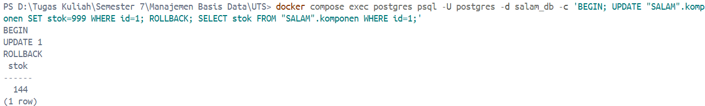

Perubahan stok dalam transaksi dibatalkan; nilai stok kembali seperti sebelum transaksi.

## Struktur Repository

```text
.
├── docker-compose.yml
├── .env.example
├── init/
│   ├── 01_roles.sh
│   ├── 02_schema_tables.sql
│   ├── 03_privileges.sql
│   ├── 04_views_triggers.sql
│   └── 05_seed.sql
├── tests/
│   ├── 10_constraint_tests.sql
│   ├── 20_privilege_tests.sh
│   └── 30_feature_demo.sql
└── docs/
    ├── evidence/
    ├── screenshots/
    └── screenshot_checklist.md
```

## Keamanan

- `.env` diabaikan oleh `.gitignore`; jangan pernah menambahkan kredensial ke repository.
- Screenshot yang memuat password tidak disertakan.
- Gunakan password unik dan kuat untuk setiap role.
- Perintah `docker compose config` dapat menampilkan hasil interpolasi environment; gunakan `docker compose config --no-interpolate` saat memeriksa konfigurasi untuk publik.

## Lisensi

Dibuat untuk keperluan akademik UIN Sunan Gunung Djati Bandung.

